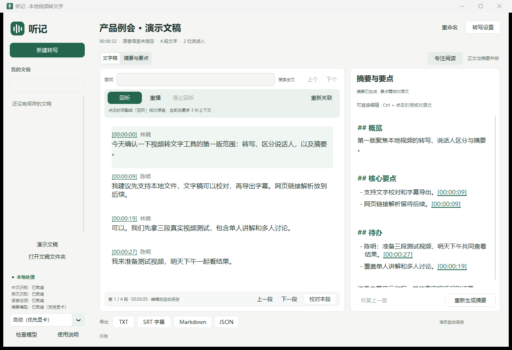

# 听记 · Tingji

本地优先的 Windows 音视频文稿工作台。把中文或英文录音整理成可搜索、可校对、可回听的文字稿，再生成带原文定位的中文摘要。

## 可以做什么

- 自动抽样判断中英文；不确定时请用户确认，英文保留英文文字稿。
- 按段识别与说话人分组，长视频中断后继续，单个文件最长 4 小时。
- 连续读稿、全文搜索、时间戳回听、段落校对、说话人调整与自动保存。
- 原文和摘要并排，支持专注阅读；摘要可编辑并恢复上一版及其生成信息。
- 本地中文摘要和会议纪要；显卡优先、CPU 回退，摘要分段与合并结果可续算。
- 导出 TXT、SRT、Markdown、JSON。无需 API Key，推理不上传音视频或文稿。

## 开始使用

目前提供源码安装，适用于 Windows x64、Python 3.12（含 tkinter）。建议先用短片段检查本机配置。已验证环境为 Windows 11、16 GB 内存、RTX 4060 Laptop 8 GB；这不是最低配置保证。

1. 下载源码 ZIP 并解压到可写目录，或执行 `git clone https://github.com/rainman016/tingji.git`。
2. 安装 Python 3.12 x64，双击 **安装本地模型.cmd**。首次安装需要联网下载依赖和约 5 GB 模型；建议预留 50 GB 磁盘，可能需要数十分钟。
3. 双击 **启动听记.cmd**，选择音视频，保持“自动检测”语言，点击“开始转写”。首次也可以打开演示文稿。
4. 如需显卡摘要，运行 **安装摘要显卡加速.cmd**；引擎经过实际显卡验证后才启用，保留原 CPU 环境。

当前完整安装器使用 PyTorch 2.8.0 / CUDA 12.6，包括 CPU 模式也会下载相应运行包。其他显卡和驱动组合需实际验证。程序及模型请放在一起；可选编译的 EXE 仅为启动器，不是免安装完整包。

## 日常使用

选择文件 → 转写 → 阅读和校对 → 生成摘要 → 导出。文字稿一旦保存即可阅读，摘要失败可以单独继续。

- `Ctrl+F` 搜索，`Enter` / `F3` 下一处，`Shift+F3` 上一处。
- 点击时间戳回听，`Ctrl+Enter` 控制回听，`Ctrl+E` 校对当前段。
- 摘要内 `Ctrl+点击` 有效时间引用定位原文。引用位置有效不代表结论已经核实。
- 摘要中断后点击“继续摘要”，复用完成步骤；“放弃续算，重新生成”开始新一轮。原文、模板或模型变化时不会混用旧缓存。
- 修改文稿后摘要会标记待更新；恢复上一版同步恢复其设备、耗时和校验信息。

详细操作见 [使用说明](使用说明.md)，开发与测试见 [贡献说明](CONTRIBUTING.md)。

## 性能与边界

RTX 4060 Laptop 本机实测：55 分钟视频的已有文字稿，摘要计算两段后停止，再由新进程继续，总用时约 107 秒（32 秒 + 75 秒），成功复用两段，最终要点覆盖前、中、后段。第五阶段的 CPU 基线约 1251 秒，固定 128-token 输出另测 GPU 约 8.2 倍提速。不同版本与输出不能视为严格等价测速，详见 [验收说明](docs/VALIDATION.md)。

识别会受口音、噪声、多人抢话与专业词影响；说话人是声音分组，不是身份识别。自动语言判断针对主要语言，不支持逐句切换模型。默认使用首条音轨，没有精细字幕切轴功能。小模型摘要可能遗漏或误解信息；逐字引文会匹配原句，概括要点的时间可能只指向附近话题，关键结论请回听核对。

## 数据与许可

文稿和恢复进度保存在 `results/`，模型在 `models/`，运行环境在 `.venv/`、`.runtime/`，临时文件在 `.tmp/`。这些目录均不应提交到 Git。首次安装联网，之后推理子进程禁用 Python 网络访问并关闭模型更新与遥测。

项目源码许可见 [LICENSE](LICENSE)。模型、FFmpeg 和其他依赖保留各自的许可，详见 [第三方来源](THIRD_PARTY_NOTICES.md)。仓库不分发模型权重或第三方运行库。
